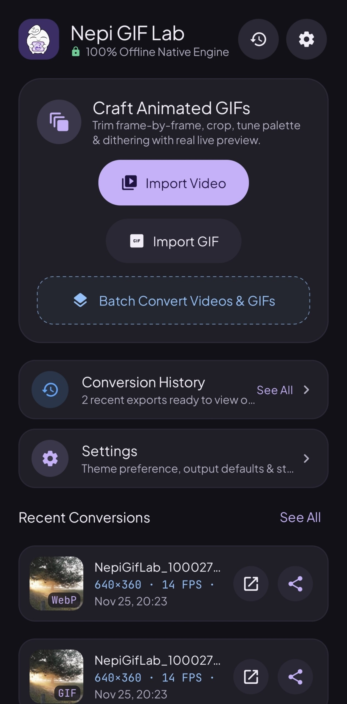
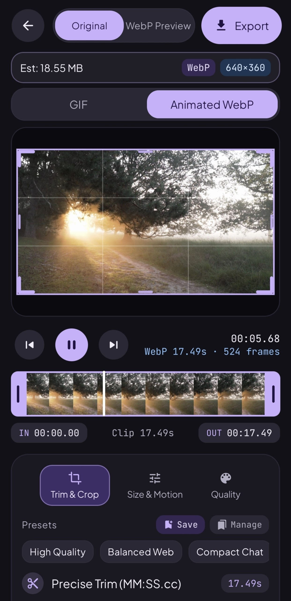
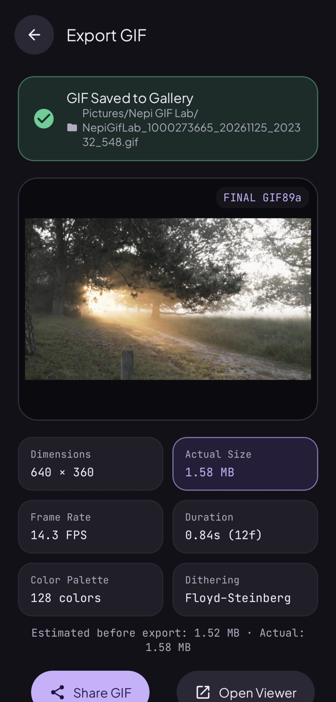
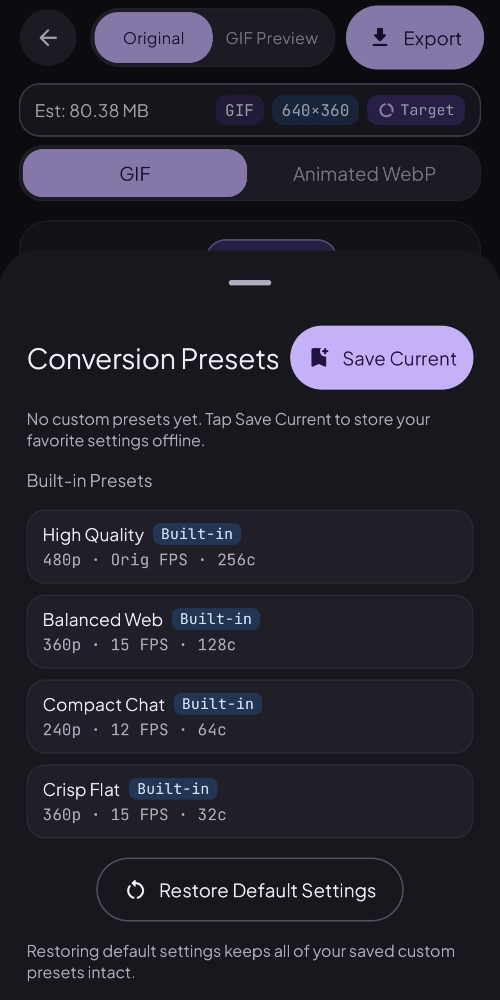
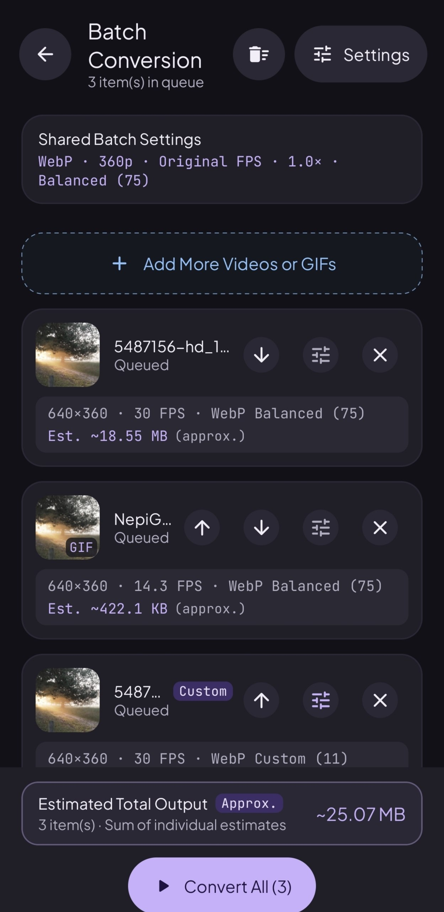

# Nepi GIF Lab

**Nepi GIF Lab** is a free, private, 100% offline native Android studio built with Kotlin and Jetpack Compose for converting videos and editing animated GIFs into optimized **GIF89a** or **Animated WebP** files.

All media decoding, frame transformation, color quantization, dithering, preview rendering, and encoding run directly on your device — with **no `INTERNET` permission**, no cloud uploads, no advertisements, no analytics, and no subscriptions.

---

## Table of Contents

- [Overview](#overview)
- [Screenshots](#screenshots)
- [Features](#features)
- [Privacy & Offline Architecture](#privacy--offline-architecture)
- [Cryptocurrency Donations](#cryptocurrency-donations)
- [Installation (APK)](#installation-apk)
- [Building from Source](#building-from-source)
- [Technical Specifications](#technical-specifications)
- [Changelog](#changelog)
- [License](#license)

---

## Overview

Nepi GIF Lab unifies **Video-to-GIF / Animated WebP conversion** and **GIF-to-GIF / Animated WebP editing** inside a single mobile workspace:

- **Import Videos or Animated GIFs**: Pick clips directly from the app or share files into Nepi GIF Lab from your gallery or other Android apps.
- **Export GIF89a or Animated WebP**: Choose classic GIF89a with fine-grained palette and dithering controls, or compatibility-first Animated WebP with lossless and lossy quality presets.
- **Completely Offline**: Zero network permissions, zero remote services, and instant cleanup of temporary buffers on completion or cancellation.

---


## Screenshots

| Home & Media Import | Trim & Crop Editor | Quality & Output Controls |
|:---:|:---:|:---:|
|  |  |  |

| Live Output Preview | Target Size & Presets | Batch Queue & History |
|:---:|:---:|:---:|
|  |  |  |


---

## Features

### Dual Input & Share-to-Nepi
- **Video Import**: Supports standard Android-compatible video formats (MP4, MOV, MKV, WebM, 3GP) using the Android Photo Picker.
- **Animated GIF Import**: Decodes GIF87a and GIF89a animations in a bounded-memory streaming pass while preserving per-frame variable delays, disposal methods, loop counts, and alpha transparency.
- **Share-to-Nepi**: Receive single (`ACTION_SEND`) or multiple (`ACTION_SEND_MULTIPLE`) videos and animated GIFs directly from other apps into the editor or batch queue.

### Dual Output Formats (GIF89a & Animated WebP)
- **Pure-Kotlin GIF89a Encoder**:
  - Median Cut color quantization with `Auto` (content-adaptive) and custom palette sizes from `2` to `256` colors.
  - Three dithering modes: `None`, `Ordered (Bayer 4×4)`, and `Floyd–Steinberg`.
  - Clean alpha transparency handling that excludes transparent pixels from palette clustering and dithering error diffusion.
- **Animated WebP Encoder**:
  - Quality presets (`Lossless`, `High`, `Balanced`, `Smaller`, and `Custom` quality slider).
  - Full-canvas frame compositing tuned for broad playback compatibility across Android gallery apps and messaging platforms.

### Trimming, Cropping, Motion & Resolution
- **Frame-Accurate Trimming**: Interactive timeline handles, frame-by-frame stepping, and direct timestamp editing.
- **Interactive Crop & Rotation**: Draggable corner/edge handles, aspect ratio presets (`Original`, `1:1`, `4:3`, `16:9`, `9:16`), numerical pixel crop dimensions, and 90° clockwise rotation.
- **Unrestricted Custom Resolution**: Presets (`Original`, `240p`, `360p`, `480p`) plus custom dimensions with locked aspect ratio and automatic clamping so output never upscales past the source.
- **Timing & Motion Effects**: Preserve original source FPS / per-frame GIF timing by default, select manual/custom FPS, adjust playback speed (`0.25×` to `4.0×`), reverse playback, or create seamless ping-pong loops.

### Live Preview, Target File Size & Presets
- **Viewport-Aware Live Preview**: Switch between Original playback and rendered Live Output preview with transparency checkerboard support and accurate palette/dithering representation.
- **File Size Estimation & Target Size Optimizer**: Preview estimated output sizes before exporting, or set a target file size limit and apply one-tap recommended resolution/FPS/quality adjustments.
- **Saved Presets**: Save, apply, rename, and delete custom conversion presets across both single-file and batch workflows.

### Batch Queue, History & Customization
- **Mixed Batch Conversion**: Queue videos and animated GIFs together with shared defaults or per-item custom settings, reorder items, retry failed items, and cancel cleanly at any time.
- **Background Processing & Notifications**: Runs conversions reliably via Android WorkManager with optional progress/completion notifications.
- **Gallery Export & Local History**: Saves exports directly to `Pictures/Nepi GIF Lab` via Android MediaStore, tracks history locally in Room (SQLite), and supports quick view, share, and deletion.
- **Themes & Haptics**: Supports Dark, Light, and System themes along with configurable tactile haptic feedback.

---

## Privacy & Offline Architecture

- **No Internet Permission**: The app manifest does not declare `android.permission.INTERNET`.
- **100% On-Device Processing**: Decoding, preview rendering, quantization, encoding, and QR code generation all run locally.
- **Zero Ads, Tracking, or Accounts**: No advertising SDKs, telemetry, analytics, or sign-in requirements.

---

## Cryptocurrency Donations

Nepi GIF Lab is completely free and ad-free. Donations are entirely optional and do not unlock or restrict any features.

Nepi currently accepts:

| Cryptocurrency | Network | Receiving address |
|---|---|---|
| BTC | Bitcoin | `bc1q94hhvl2el957z5z5y0tuh2umra5gze2p2uyz07` |
| BNB | BNB Smart Chain (BEP20) | `0xcef301F37CBE1a97C8c9130d8401AE24da1072A2` |
| ETH | Ethereum Mainnet (ERC20) | `0xcef301F37CBE1a97C8c9130d8401AE24da1072A2` |
| USDT | Ethereum Mainnet (ERC20) | `0xcef301F37CBE1a97C8c9130d8401AE24da1072A2` |
| USDT | TRON (TRC20) | `TUUsKYeifSGDW8LUXhm1CabfxGSYbmjLvR` |

### Important transfer information

- Always select the correct cryptocurrency and network before sending.
- Never send an asset through a network that does not match the receiving instructions.
- BNB BEP20, ETH ERC20, and USDT ERC20 share the same EVM-compatible receiving address, but represent different assets and networks.
- Cryptocurrency transactions are generally irreversible.
- Never send private keys or wallet recovery phrases.

### In-app donation experience

The Android app provides:
- Locally generated QR codes.
- One-tap receiving-address copying.
- Explicit cryptocurrency and network labels.
- Transfer warnings.

---

## Installation (APK)

### Device Requirements
- **Android**: 7.0 (API Level 24) or higher
- **Storage**: At least 50 MB free internal storage plus space for exported animations

### Sideloading a Release APK
1. Download the signed APK (and `.sha256` checksum file, if provided) from the repository's **Releases** page.
2. *(Optional)* Verify the APK SHA-256 checksum:
   - **Linux / macOS**: `sha256sum <apk-filename>.apk` (or `shasum -a 256 <apk-filename>.apk`)
   - **Windows (PowerShell)**: `Get-FileHash .\<apk-filename>.apk -Algorithm SHA256`
3. Transfer or open the APK on your Android device and allow installation from your browser or file manager if prompted.
4. Install and launch **Nepi GIF Lab**.

---

## Building from Source

### Prerequisites
- **Android Studio** (or command-line Android SDK tools)
- **JDK**: 17 or higher (for running Gradle / AGP 9)
- **Android SDK**: Platform 36 (`compileSdk = 36`, minor `1`) and Build-Tools

### 1. Clone and Configure SDK
```bash
git clone <repository-url>
cd nepi-gif-lab
```
Create a local `local.properties` file pointing to your Android SDK (or set `ANDROID_HOME`):
```properties
sdk.dir=/path/to/your/android/sdk
```

### 2. Run Unit & Robolectric Tests
```bash
# Linux / macOS
./gradlew :app:testDebugUnitTest

# Windows
.\gradlew.bat :app:testDebugUnitTest
```

### 3. Build a Debug APK
```bash
# Linux / macOS
./gradlew :app:assembleDebug

# Windows
.\gradlew.bat :app:assembleDebug
```
Output APK: `app/build/outputs/apk/debug/app-debug.apk`

### 4. Build a Signed Release APK
Release signing reads keystore details strictly from environment variables (no credentials are committed to source):

```bash
# Linux / macOS
export KEYSTORE_PATH="/path/to/your/release-keystore.jks"
export STORE_PASSWORD="your-store-password"
export KEY_PASSWORD="your-key-password"
./gradlew :app:assembleRelease
```

```powershell
# Windows (PowerShell)
$env:KEYSTORE_PATH="C:\path\to\your\release-keystore.jks"
$env:STORE_PASSWORD="your-store-password"
$env:KEY_PASSWORD="your-key-password"
.\gradlew.bat :app:assembleRelease
```
Output APK: `app/build/outputs/apk/release/Nepi-GIF-Lab-v{versionName}.apk`

---

## Technical Specifications

| Specification | Value |
| :--- | :--- |
| **Application Name** | Nepi GIF Lab |
| **Application ID** | `com.nepimeshi.nepigiflab` |
| **Version** | `1.2.6` (`versionCode = 3`) |
| **Minimum SDK** | Android 7.0 (API Level 24) |
| **Target / Compile SDK** | Android 16 (API Level 36) |
| **Language & UI** | Kotlin, Jetpack Compose (Material 3) |
| **Persistence** | Room (SQLite) + Jetpack DataStore |
| **Background Execution** | Jetpack WorkManager |
| **Output Directory** | `Pictures/Nepi GIF Lab` (MediaStore) |

---

## Changelog

Current release: **`v1.2.6` (`versionCode 3`)** — updates the Android Application ID and namespace to `com.nepimeshi.nepigiflab`, adds automatic versioned release APK naming (`Nepi-GIF-Lab-v{versionName}.apk`), and builds on full Video & Animated GIF import, GIF89a and compatibility-first Animated WebP export, viewport-aware live previews, saved presets, target file size optimization, batch queue management, Share-to-Nepi intents, and optional offline cryptocurrency donations.

See [`CHANGELOG.md`](./CHANGELOG.md) for the full release and development history.

---

## License

This project is licensed under the [MIT License](LICENSE).
